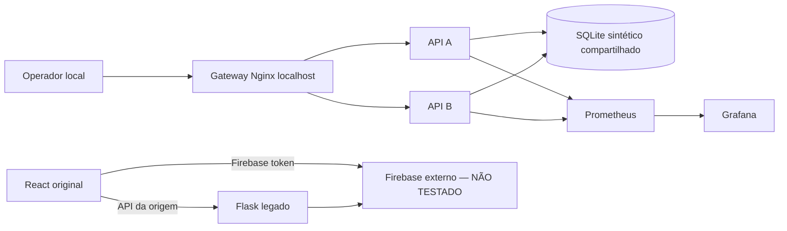

# Modelagem de ameaças — STRIDE (V6)

**Escopo:** laboratório em localhost, sem dados pessoais reais. Não implica que controles do laboratório equivalham às regras Firebase da origem. A implementação original precisa de modelagem adicional envolvendo regras Firebase e credenciais do service account.

## Fluxo de dados e limites de confiança

**Fronteira 1:** navegador → gateway; dados totalmente controlados pelo operador local. **Fronteira 2:** gateway → APIs privadas; cabeçalhos de identidade só são válidos após HMAC verificado. **Fronteira 3:** API → volume SQLite; consultas parametrizadas e checagem por proprietário. **Fronteira 4:** servidor Flask legado → Firebase externo; não testada, depende de autorização do proprietário das credenciais. **Fronteira 5:** Prometheus → endpoints privados de métricas.

## STRIDE

| Categoria | Ameaça | Mitigação local V6 | Risco residual |
|---|---|---|---|
| S — Spoofing | Forjar usuário no header | HMAC SHA-256 comparado em tempo constante, expiração | endpoint demo emite token a qualquer usuário sintético local; proibida exposição pública |
| T — Tampering | Alterar curso de outro instrutor | dono verificado no servidor antes de UPDATE/DELETE | verificar integrações Firebase originais |
| R — Repudiation | negar exclusão/alteração | audit_events + JSON request ID + instance | eventos SQLite podem ser alterados pelo operador; não são provas imutáveis |
| I — Information Disclosure | tokens em URL/logs e erros | bearer headers; logs sem query/token; mensagens genéricas | logs Nginx padrão exigem inspeção antes de produção; TLS ausente no loopback |
| D — Denial of Service | body gigante / brute-force demo | 32 KiB e rate limit SQLite | limites não substituem WAF, proteção por IP de origem real não deve confiar no X-Forwarded-For |
| E — Elevation of Privilege | estudante vira autor/admin | papéis assinados e autorização per-object | seletor público de perfis é *intencional* no laboratório; não usar em produção |

## Hipóteses que exigem validação

- O app original tem acessos Firebase definidos em regras de Realtime Database? Como se restringe `users/{uid}` por token? Não inferir sem configuração real.
- CORS da origem permite leitura de dados sensíveis no navegador sem bearer explícito? CORS amplo por si só é insuficiente para afirmar vazamento.
- Como a aplicação mantém sessão no React e renova tokens? Verificar sem contas de terceiros.
- SQL legado do blueprint desativado deve ser ativado com SQLite sintético somente se necessário para comprovar a origem.

## Aceite do modelo

Threat model só será marcado como validado quando cada trust boundary tiver um teste de ameaça reproduzível, severidade e dono do controle. Modelo atual: documentação de projeto, não pentest completo.
